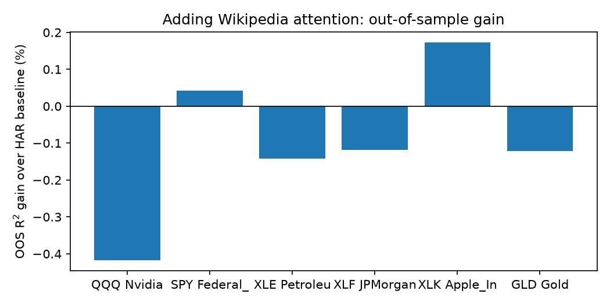

# Does Wikipedia attention predict ETF volatility?

> **Short answer: no, not out-of-sample.** Adding lagged Wikipedia pageview changes to a
> HAR-style volatility baseline gives no statistically significant gain on any of six
> ETF/article pairs (2016–2026). This repo is the pipeline that shows it, and a null result is
> reported as a null result.

## Setup

- **Target**: log of the 5-day realized volatility (std of daily log returns) of an ETF, day *t*.
- **Baseline (HAR-RV style)**: log rv5, log rv22 and log |return|, all at *t-1*. OLS.
- **Attention model**: baseline + daily log-change of the article's pageviews at *t-1* and *t-2*.
- **Strictly lagged features**: nothing dated *t* or later enters the design matrix.
- **Walk-forward validation**: expanding window, 750-day burn-in, refit every 21 trading days;
  each prediction comes from a model fitted only on the past.
- **Test**: Diebold–Mariano on squared-error differences with Newey–West (HAC, 5 lags) standard
  errors (the 5-day windows overlap, so errors are autocorrelated), one-sided
  (H1: attention model better), **Holm-corrected** across the six pairs.
- **Stationarity**: ADF test on the target and on the attention feature (all p < 0.001).
- Data: Yahoo Finance daily adjusted closes (`yfinance`) and Wikimedia pageviews
  (English Wikipedia, all-access, user agents), 2016-01-01 → 2026-10-31, 1950 out-of-sample days per pair.

<!-- TODO (Alessio): short math section: why log-returns / log-diff of views are I(0), definition of
     realized volatility, the DM statistic and the HAC variance. -->

## Results

| ETF | Wikipedia article | Baseline OOS R² | Attention gain (OOS R²) | DM stat | p (one-sided) | p (Holm) |
|---|---|---|---|---|---|---|
| QQQ | Nvidia | 0.757 | −0.42 % | −1.76 | 0.961 | 1.00 |
| SPY | Federal Reserve | 0.778 | +0.04 % | 0.20 | 0.421 | 1.00 |
| XLE | Petroleum | 0.730 | −0.14 % | −1.63 | 0.948 | 1.00 |
| XLF | JPMorgan Chase | 0.744 | −0.12 % | −0.85 | 0.801 | 1.00 |
| XLK | Apple Inc. | 0.740 | +0.17 % | 1.08 | 0.140 | 0.84 |
| GLD | Gold | 0.728 | −0.12 % | −1.42 | 0.922 | 1.00 |

(Baseline R² is against an expanding-mean forecast; it is high because volatility is very persistent.
Full table: [`results/results.csv`](results/results.csv).)




**Reading.** Volatility persistence (`rv5`, `rv22`) explains almost everything. The attention
features move the out-of-sample error by less than half a percent in either direction; four of six
pairs get *worse*, and the best pair (XLK/Apple) is not significant even before correction
(p = 0.14), let alone after.

## Limitations

- Six hand-picked pairs, one lag structure, linear model. A null here does not rule out
  non-linear or event-driven effects (e.g. only on attention spikes).
- Daily close-to-close volatility is a noisy proxy; intraday realized volatility would be sharper.
- Pageviews are a noisy attention proxy (bots, news unrelated to the asset, article renames).
- No trading rule or transaction costs: this is a forecasting test, not a strategy.
- Earlier prototype (QQQ/Nvidia, 2025-2026 only, Ridge, no baseline) is superseded by this version;
  its fold R² could not separate attention from plain volatility persistence.

## Reproduce

```bash
python -m venv venv && venv\Scripts\activate    # Windows; use venv/bin/activate on Linux/macOS
pip install -r requirements.txt
python -m src.model_pipeline                    # downloads (cached in data/), writes results/
```

Everything lives in `src/model_pipeline.py`; pairs and dates are set in `PAIRS` / `main()`.
Downloaded data goes to `data/` (git-ignored); `results/` holds the committed table and figures.
