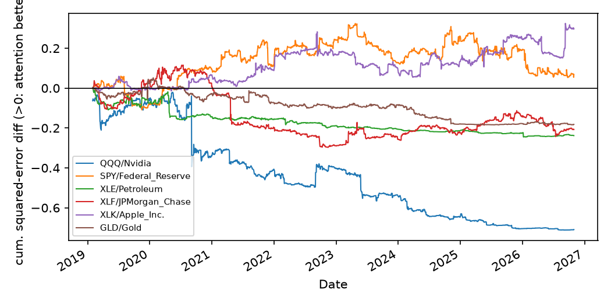

# Does Wikipedia attention predict ETF volatility?

> **Short answer: no, not out-of-sample.** Adding lagged Wikipedia pageview changes to a
> HAR-style volatility baseline gives no statistically significant gain on any of six
> ETF/article pairs (2016-2026), neither with a linear model nor with gradient boosting.
> A weak hint on XLK/Apple (Clark-West raw p = 0.019) disappears after multiple-testing correction
> (Holm p = 0.11). A null result is reported as a null result.

**Notebooks** (executed, with figures and explanations; start here):

| Notebook | Content |
|---|---|
| [`01_data_and_concepts`](notebooks/01_data_and_concepts.ipynb) | Financial glossary, data, volatility clustering, stationarity (ADF), first look at attention vs volatility |
| [`02_baseline_vs_attention`](notebooks/02_baseline_vs_attention.ipynb) | HAR baseline, walk-forward validation, out-of-sample R², all pairs |
| [`03_significance_tests`](notebooks/03_significance_tests.ipynb) | Diebold-Mariano, Clark-West, HAC, Holm; simulation of test size |
| [`04_ml_extension`](notebooks/04_ml_extension.ipynb) | Gradient boosting with richer attention features; what deep learning could add |
| [`05_intraday_extension`](notebooks/05_intraday_extension.ipynb) | Intraday realized variance (15-min bars), HAR-RV, weekday-seasonality trap, results |
| [`06_sip_panel_earnings`](notebooks/06_sip_panel_earnings.ipynb) | Consolidated tape (SIP, 5-min, 2016-2026), panel of 15 pre-specified pairs with pooled test, earnings-window test |
| [`07_stocks_idiosyncratic_earnings`](notebooks/07_stocks_idiosyncratic_earnings.ipynb) | 20 single stocks, idiosyncratic attention, earnings events (date check, cluster-robust test), signature plot and subsampled RV |

## Financial concepts used (short glossary; full version in notebook 01)

- **ETF**: exchange-traded fund, a basket of assets traded like a stock (QQQ = Nasdaq-100, SPY = S&P 500, XLE energy, XLF financials, XLK technology, GLD gold). Liquid and diversified, hence a clean volatility signal.
- **Adjusted close**: closing price corrected for dividends/splits, so that price changes equal investor returns.
- **Log return**: r_t = ln(P_t / P_{t-1}); additive over time and approximately stationary.
- **Volatility**: standard deviation of returns; the market's measure of risk (drives option prices, position sizing, VaR).
- **Realized volatility (RV)**: volatility *measured* on past returns (here the std of the last 5 or 22 daily returns). **Implied volatility** is instead the expectation backed out of option prices (not used here, needs option data).
- **Volatility clustering**: volatility is highly persistent (calm follows calm). It makes volatility forecastable and makes the baseline hard to beat.
- **HAR-RV** (Corsi 2009): regression of volatility on its own daily/weekly/monthly past; the standard benchmark.
- **Stationarity / ADF test**: a stationary series has stable moments; regressions on non-stationary (unit-root) series are spurious. ADF tests H0 = unit root.
- **Look-ahead bias**: using information not available at forecast time; the most common reason backtests are too good.
- **Walk-forward validation**: train on the past, test on the next block, move forward; never train on the future.
- **Out-of-sample R²**: 1 - SSE(model)/SSE(benchmark) on unseen data; can be negative.
- **Diebold-Mariano / Clark-West / HAC / Holm**: forecast-comparison tests, nested-model correction, autocorrelation-robust variance, multiple-testing correction. Explained in notebook 03.

## Setup

- **Target**: y_t = ln RV5_t, log of the std of the 5 daily log returns ending at day t.
- **Baseline (HAR-style, OLS)**: ln RV5, ln RV22 and ln|r| at t-1.
- **Attention model**: baseline + daily log-change of the article's pageviews at t-1 and t-2.
- **Strictly lagged**: nothing dated t or later enters the features (checked by `tests/test_no_lookahead.py`).
- **Walk-forward**: expanding window, 750-day burn-in, refit every 21 trading days.
- **Tests**: Diebold-Mariano and Clark-West on squared-error differences with Newey-West (5 lags) errors, one-sided (H1: attention helps), Holm-corrected over the six pairs; ADF on target and feature.
- **Data**: Yahoo Finance adjusted closes (`yfinance`), Wikimedia pageviews (English Wikipedia, all-access, user agents), 2016-01-01 to 2026-10-31, 1950 out-of-sample days per pair.

### Mathematics in brief

- Log return r_t = ln(P_t/P_{t-1}); RV5_t = sqrt( (1/4) sum_{i=0..4} (r_{t-i} - mean)^2 ).
- HAR: y_t = b0 + b1 ln RV5_{t-1} + b2 ln RV22_{t-1} + b3 ln|r_{t-1}| + e_t, estimated by OLS on the training window only.
- Loss differential d_t = e_base,t^2 - e_alt,t^2. DM statistic: dbar / sqrt(Var_HAC(dbar)), Newey-West variance
  (1/n)(g0 + 2 sum_{k=1..L} (1 - k/(L+1)) g_k). Clark-West replaces d_t by e_base^2 - (e_alt^2 - (yhat_base - yhat_alt)^2) because the models are nested.
- Holm: sort the m p-values, reject the k-th smallest if p_(k) <= alpha/(m-k+1) (and all smaller ones were rejected).

Derivations and intuition are in notebooks 02 and 03.

## Results

| ETF | Wikipedia article | Baseline R² (vs mean) | Attention gain (OOS R²) | DM p | Clark-West p | CW p (Holm) |
|---|---|---|---|---|---|---|
| QQQ | Nvidia | 0.757 | -0.42 % | 0.961 | 0.843 | 1.00 |
| SPY | Federal Reserve | 0.778 | +0.04 % | 0.421 | 0.099 | 0.49 |
| XLE | Petroleum | 0.730 | -0.14 % | 0.948 | 0.921 | 1.00 |
| XLF | JPMorgan Chase | 0.744 | -0.12 % | 0.801 | 0.430 | 1.00 |
| XLK | Apple Inc. | 0.740 | +0.17 % | 0.140 | 0.019 | 0.11 |
| GLD | Gold | 0.728 | -0.12 % | 0.922 | 0.835 | 1.00 |

Full table: [`results/results.csv`](results/results.csv); ML extension: [`results/ml_results.csv`](results/ml_results.csv).




**Reading.** Volatility persistence explains almost everything (baseline R² about 0.73-0.78). Attention moves the out-of-sample error by less than half a percent either way; four of six pairs get *worse*. A simulation (notebook 03) shows DM is too conservative for nested models (rejects 0.7% of the time under a true null) while Clark-West is near its nominal size (4.7%), so the null is not an artifact of a timid test. The ML extension (notebook 04) finds the same: gradient boosting is *worse* than the linear HAR and attention features do not help it either.

### Error bars in the figures

Bars are 95% intervals for the OOS R² gain: Newey-West (HAC, 5 lags) standard error of the mean squared-error difference, divided by the baseline's mean squared error (`r2_gain_se` in the CSVs). They are **Diebold-Mariano-type intervals, i.e. conservative for nested models** (the same reason DM rejects too rarely, notebook 03): an interval that includes zero does not contradict a small Clark-West p-value. What they show clearly is the *size* of the uncertainty: in the six-pair daily analysis, SIP intraday analysis, 15-pair panel and 20-stock panel **no interval excludes zero** (the only exception is one stock's earnings-day gain in the raw-attention version, 1 of 20), and the intervals are typically as wide as the gains themselves (about +/-0.3 percentage points on the daily target). Earlier versions of the figures showed point estimates only; this was an omission.

## Critical review: assumptions, alternatives, difficulty

### Initial assumptions and how solid they are

1. **Wikipedia pageviews proxy attention.** Plausible (Moat et al. 2013, Preis et al. 2013) but noisy: bot traffic, news unrelated to the asset, article renames. A company article is also an indirect proxy for an index ETF where the company is one holding among many (Nvidia is only one holding of QQQ).
2. **One article per ETF, picked by hand.** Arbitrary; reading the answer off six pairs is already a multiple-testing situation (hence Holm).
3. **Daily close-to-close volatility is a good volatility measure.** It is noisy. The standard now is *intraday realized volatility* from 5-minute returns, which is much more precise.
4. **Target = RV5 ending at t, features at t-1.** Four of five returns in the target window are already in the feature `ln RV5_{t-1}`; this is a forecast of the *next window*, not strictly of "tomorrow's return". It is legitimate (no look-ahead) but it means the target is smooth and easy to predict, which inflates the baseline R² and leaves little room for any extra feature.
5. **Linear, stable relationship; expanding window.** Assumes the relationship does not change over 10 years (it probably does: attention regimes differ between 2016 and 2024).
6. **Log-change of views as the feature.** Removes the popularity trend but is very noisy at low view counts (large percentage swings from tiny absolute numbers).
7. **Statistical assumption:** DM/CW need stationary loss differentials with short memory; HAC with 5 lags is a convention (the 5-day overlap), not a derived optimum.

### What we could have done differently

- **Intraday data** for the target: done in the extension below (15-minute bars); consolidated-tape 1-5 minute data would be better.
- **Forecast a clean horizon** (next-day or next-5-days-ahead volatility with non-overlapping targets) instead of a rolling window ending today.
- **Pooled panel over many ETF/article pairs** with a pre-registered pair list; tests the average effect with far more data and removes the "which pair" freedom.
- **Event-based design**: attention matters mostly around earnings, launches, scandals; condition on spikes (z-score of views) rather than on all days.
- **Better attention data**: Google Trends, news counts, edit activity, or Wikipedia views of *several* related articles.
- **Implied volatility (VIX/option data) as benchmark**: if implied volatility already prices in the news, attention adds nothing by construction.
- **Other baselines**: GARCH-family models, HAR with leverage/jump terms, realized-kernel estimators.
- **Rolling instead of expanding window**, and a check for structural breaks.

### What is hardest

1. **Beating the benchmark, not building the model.** The hard part is the honest comparison: volatility is so persistent that any feature must add information *beyond* past volatility, and the expected effect size is tiny compared with the noise.
2. **Inference, not prediction.** Overlapping targets, nested models and several pairs each break the textbook t-test. DM, HAC, Clark-West and Holm are all needed to avoid fooling ourselves; getting each right (and showing by simulation that the tests behave) was the most delicate part.
3. **Avoiding look-ahead subtly.** Calendar alignment (Wikipedia has weekend views, ETFs do not), lags, scaling inside the training window, and not tuning hyper-parameters on the test period all matter.
4. **Data fragility.** `yfinance` changes defaults (auto-adjusted prices, MultiIndex columns) and APIs rate-limit; data are cached in `data/` for reproducibility.

## How machine learning / deep learning could be used

Already implemented (notebook 04): **gradient-boosted trees** on baseline + richer attention features (5-day mean of views changes, 60-day z-score of log views). Result: worse than HAR, no gain from attention. Why ML underperforms here: ~2,000 daily points, near-linear persistent dynamics.

Natural extensions, in order of expected value:

1. **Better target first** (intraday realized volatility), then richer models.
2. **Pooled panel model** over many ETF/article pairs with ticker embeddings (gradient boosting or a small neural net): gives the sample size ML needs and tests the average attention effect.
3. **Sequence models (LSTM/GRU/temporal CNN)** on raw return and view sequences. Published gains over HAR are small and fragile; they require the pooled panel and nested validation for hyper-parameters (never tune on the test period).
4. **NLP on article edit text or news** (transformer embeddings) to capture *what* is being discussed, not just how many visits.
5. **Quantile / probabilistic forecasts** (e.g. quantile gradient boosting) to predict tail-volatility events where attention may matter more than for the mean.

Caveat for all of them: more flexible models increase the risk of overfitting and of look-ahead leaks; the same walk-forward + Holm discipline applies.

## Intraday extension (realized variance from 15-minute bars)

To address the main weakness of the daily design (noisy, overlapping target), `src/intraday.py` builds the **daily realized variance** RV_t = sum of squared 15-minute log returns in the 09:30-16:00 session (Andersen-Bollerslev 1998), from Alpaca's free IEX feed (history from 2020-07-27, about 800 test days). Target = ln RV_t, one day, non-overlapping; baseline = HAR-RV (day, 5-day and 22-day averages of past RV).

**Finding.** Without further controls, Clark-West + Holm flags QQQ/Nvidia (p = 0.011) and XLE/Petroleum (p = 0.013): it would look like a discovery. But Wikipedia traffic and volatility both have weekday seasonality, so a "views change" feature can predict volatility just by encoding the weekday. Adding weekday dummies to *both* models cuts the gains by more than half (QQQ: 0.61% to 0.26%) and **no pair survives Holm** (best adjusted p = 0.149). Gradient boosting shows no significant gain either. What remains is a small, positive, non-significant hint on tech pairs, with low power (~800 test days, IEX is only 2-3% of volume). Details in notebook 05 and [`results/intraday_results.csv`](results/intraday_results.csv). Re-downloading the bars needs a free Alpaca account (`ALPACA_KEY`, `ALPACA_SECRET` environment variables); the bars are cached in `data/` (not committed).

### Consolidated tape, panel and earnings windows (all free data)

A free Alpaca key also serves the **SIP** feed (consolidated tape of all US exchanges): 5-minute bars from 2016, i.e. **1951 test days** instead of 800 (`src/intraday.py`, `results/intraday_sip_results.csv`). `src/panel.py` adds a **panel of 15 pre-specified pairs** (14 company/ETF pairs plus macro; list fixed before any result; Amazon and Meta articles excluded for broken histories after Wikipedia renames), weekday and earnings-day controls in both models, a **pooled test** and an **earnings-window test** (earnings dates from `yfinance`, unofficial). Results: [`results/panel_results.csv`](results/panel_results.csv), notebook 06.

- Per pair: none significant after Holm once weekday effects are controlled (without that control, four of the original six look "significant": the same calendar artifact as above).
- Pooled Clark-West over 15 pairs: p = 0.025 (one-sided), but the **mean OOS R² gain is -0.06%** and negative for 11 of 15 pairs: a statistically faint signal with no practical forecasting value.
- Earnings reaction days (~31 per company): gains up to +5% for Nvidia (raw p = 0.015 and 0.022), but p = 0.18 / 0.24 after Holm over 12 tests. Suggestive, not significant.

### Single-stock panel, idiosyncratic attention, earnings events

`src/stocks.py` tests attention to a company against the realized variance of **that company's own stock** (20 large caps, SIP 5-min, list fixed in advance), with weekday and own-earnings controls ([`results/stocks_results_raw.csv`](results/stocks_results_raw.csv), [`results/stocks_results_idio.csv`](results/stocks_results_idio.csv), pooled tests in `results/stocks_pooled_*.csv`, notebook 07).

- **Common-factor trap.** With raw attention the pooled Clark-West test is "hugely significant" (p = 2e-5) and Nvidia survives Holm (p = 0.013). Subtracting the cross-stock average attention change (idiosyncratic attention, which removes market-wide Wikipedia traffic movements such as holidays and summer lulls) the pooled test falls to p = 0.097, Nvidia to 0.082 after Holm, and the mean OOS R² gain is **-0.10%, negative for 19 of 20 stocks**. The raw "signal" was market-wide traffic tracking market-wide volatility.
- **Earnings dates checked**: realized variance on reaction days is 2.4-4.1x normal for all 20 stocks, so the unofficial `yfinance` dates are reliable (SEC EDGAR was not used: it needs a personal contact e-mail in every request).
- **Earnings reaction day** (627 stock-events): idiosyncratic attention gives +0.49% OOS R² on average (positive for 14 of 20), pooled p = 0.023 treating events as independent, **p = 0.064 after averaging within calendar weeks**; 3-day window p = 0.24-0.28. A hint that deserves a pre-registered replication, not a result (several tests were run).
- **Microstructure noise**: signature plot shows ~20% higher mean RV at 5 than at 60 minutes. A subsampled 10-minute RV (2 offsets) leaves the conclusion unchanged; SPY/Fed stays a borderline hint (Holm p = 0.06 at 5 min, 0.04 subsampled, 0.145 in the 15-pair panel).

## Limitations

- Six hand-picked pairs, linear and tree models without tuning; a null here does not rule out effects around specific events.
- The daily analysis uses close-to-close volatility (noisy); the intraday extension fixes this but only has IEX bars (2-3% of volume) from mid-2020.
- No trading rule or transaction costs: this is a forecasting test, not a strategy.
- The earlier prototype (QQQ/Nvidia 2025-2026, Ridge, no baseline) is superseded; its fold R² could not separate attention from volatility persistence.

## Reproduce

```bash
python -m venv venv && venv\Scripts\activate    # Windows; use venv/bin/activate on Linux/macOS
pip install -r requirements.txt
python -m src.model_pipeline                    # downloads (cached in data/), writes results/
python -m src.intraday                          # intraday extension, SIP 5-min (needs ALPACA_KEY / ALPACA_SECRET, ~25 min first run)
python -m src.panel                             # 15-pair panel + earnings windows
python -m src.stocks                            # 20 single stocks, raw and idiosyncratic attention
python -m pytest tests                          # optional: no-look-ahead check (needs pytest)
jupyter nbconvert --to notebook --execute --inplace notebooks/0*.ipynb   # re-run notebooks (needs jupyter)
```

Core code: `src/model_pipeline.py` (data, features, walk-forward, tests). Pairs and dates are set in `PAIRS` / `main()`.
Downloaded data goes to `data/` (git-ignored); `results/` holds the committed tables and figures.

## References

Corsi (2009) *A simple approximate long-memory model of realized volatility*, J. Financial Econometrics. Diebold & Mariano (1995) *Comparing predictive accuracy*, JBES. Clark & West (2007) *Approximately normal tests for equal predictive accuracy in nested models*, J. Econometrics. Newey & West (1987), Econometrica. Holm (1979), Scand. J. Statistics. Campbell & Thompson (2008), RFS. Moat et al. (2013) *Quantifying Wikipedia usage patterns before stock market moves*, Sci. Rep. Preis, Moat & Stanley (2013) *Quantifying trading behavior in financial markets using Google Trends*, Sci. Rep. Mandelbrot (1963); Engle (1982). Andersen & Bollerslev (1998) *Answering the skeptics: yes, standard volatility models do provide accurate forecasts*, Int. Economic Review. Barndorff-Nielsen & Shephard (2002), JRSS-B. Zhang, Mykland & Ait-Sahalia (2005) *A tale of two time scales*, JASA.
